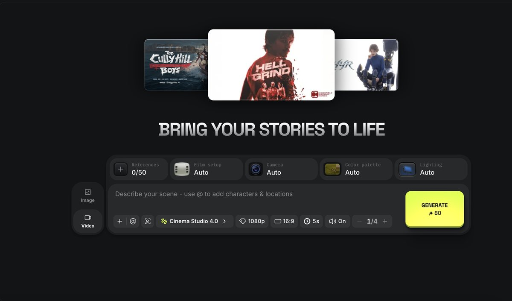
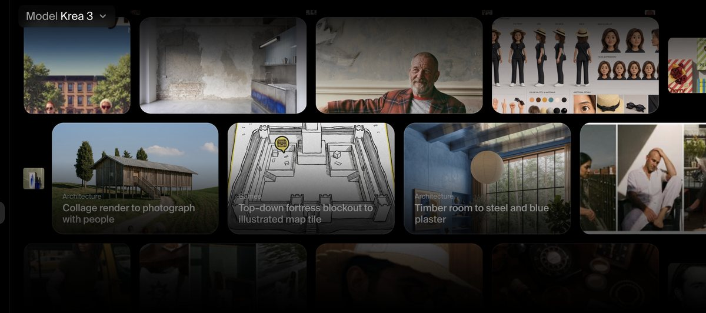

# Product Thinking

## 1. What problem were you trying to solve? What type of user did you design for?

Designers who make images all day for a client. Think a campaign for a candle brand.

The problem: after 200 images you can't find the good ones, and you forget which prompt made them. Most tools just show one long feed, so you lose track fast.

## 2. What are the three most important UX decisions you made? Why?

1. **Branches, not a feed.** Each new set of images sits next to the one it came from, with a line between them. So you can always see how you got somewhere and go back.

2. **Change one thing at a time.** The prompt is split into parts: subject, scene, light, mood, props. To try something new you change one part and keep the rest. The card shows what changed, like "Light: golden hour". The brand rules get added to every prompt by themselves, so you don't type them again.

3. **Fast picking.** Choosing takes longer than making. So there are shortcuts: arrows to move, P to pick, X to reject, C to compare, B to branch, ⌘K for everything else. Picks go to a tray and you can export them with their prompts.

## 3. Which features did you intentionally leave out? Why?

- **Node editor** (like ComfyUI). Too complex for most people. Lanes are simpler.
- **Comments and sharing.** Useful for teams, but not needed to make and pick images.
- **Editing tools** like masks. That's a different page.
- **AI prompt rewriting.** It hides what changed, and seeing changes is the whole point.
- **Saving to a database.** Out of scope for a frontend task. Everything resets on reload.

## 4. Which existing products inspired your thinking? What did you like? What would you improve?

**Higgsfield.** I liked how easy it is to get started. You can try it right away without signing up, and it gives you 80 credits. Everything is in one simple bar: add references, use @ to add characters and locations, upload images, and pick the camera, colours and lighting. Would improve: once you have lots of results, it's hard to tell which settings made which image.

**Krea.** I liked the effects and animations. They're simple and they mean something. Scrolling through images feels natural, and the UI is very simple. Would improve: older results get lost as you keep going.

## 5. If you had another month, what would you improve?

- Save projects and add undo
- Mix two branches into one
- Warn when an image breaks the brand rules (wrong colours, text in the image)
- Share links so a client can pick images
- Video branches
- Test with real designers and remove what they don't use

## 6. What is the single feature or workflow that differentiates this workspace from existing AI creative platforms?

Branching. Pick an image, change one thing, and you get a new set right next to it, with a note saying what changed. Every image keeps its full recipe till export.

## 7. Design trade-offs: what did you prioritize, simplify and remove, and why?

- **Prioritized:** the main loop (make, compare, pick) and keyboard speed.
- **Simplified:** fixed lanes instead of a free canvas. Easier to read, less freedom.
- **Simplified:** one branch generates at a time. No queue to manage.
- **Removed:** a separate history page in the studio. The branches already are the history.
- **Part A changes from the mockup:**
  - Empty canvas puts the prompt in the middle, with picture examples under it instead of empty space. After the first result it slides into the side panel (bottom bar on phones), so you end up in the mockup layout
  - Main area shows only your current work. Old runs stay in the history strip at the top, so nothing shows twice
  - Generate button colour made darker, the original was hard to read
  - Nav highlight follows Image or Video
  - Default ratio 2:3 to match the mockup images
  - 4 columns on tablet so image sets don't leave one alone on a row
- **Fake backend:** picks stock photos by keywords. Not real AI, but good enough to test the UI.
