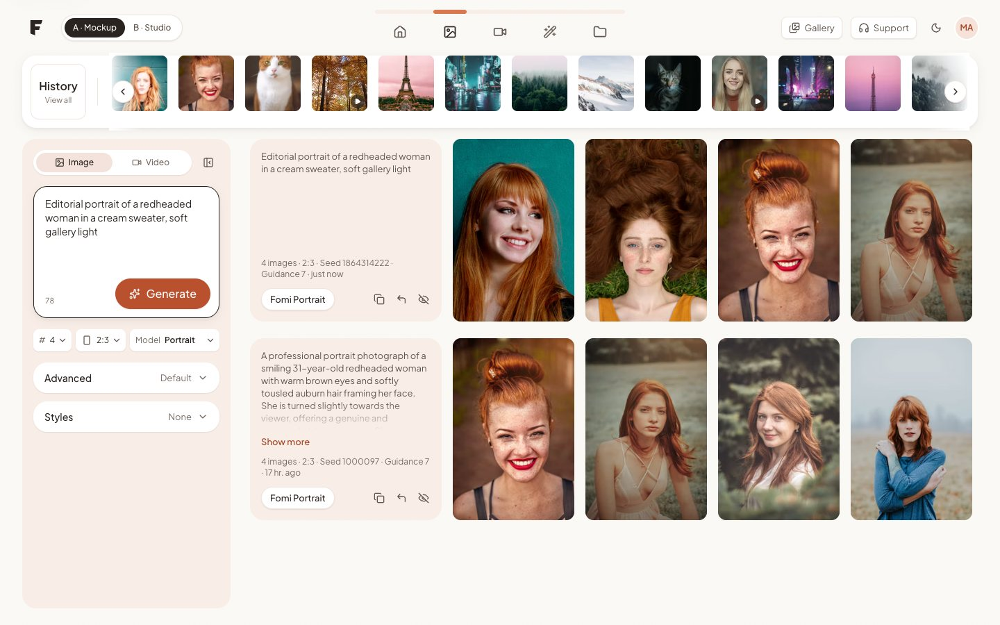
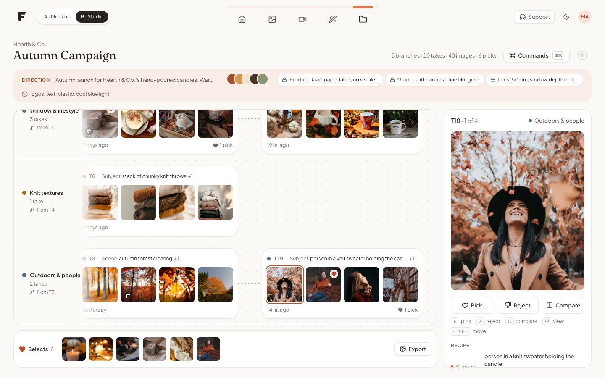
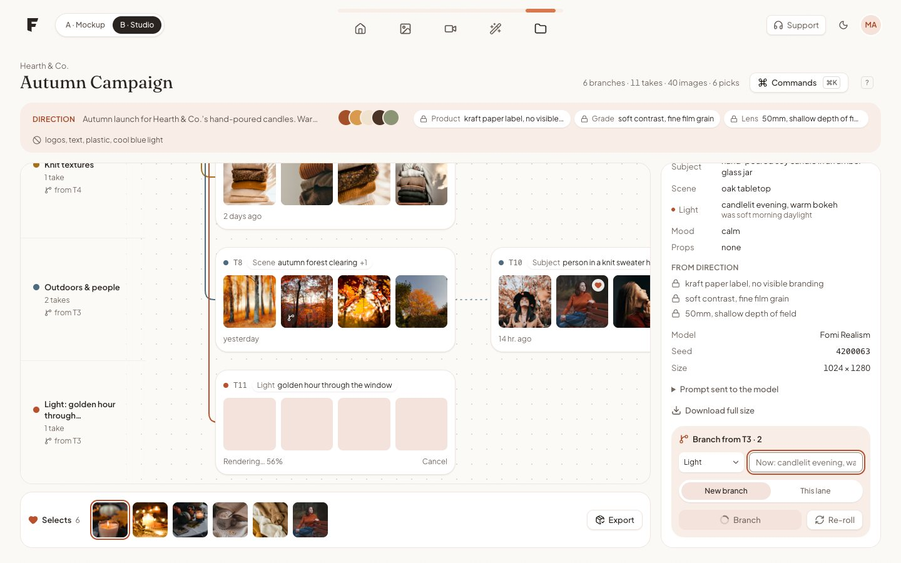
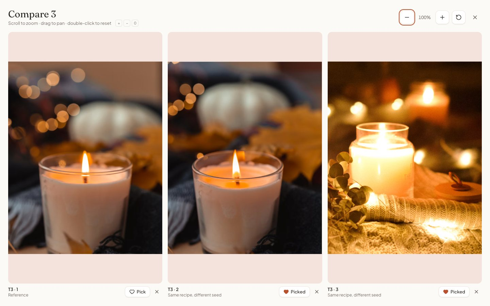
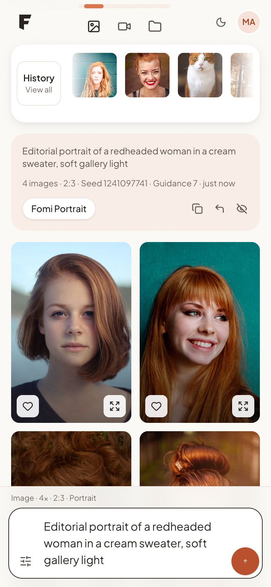
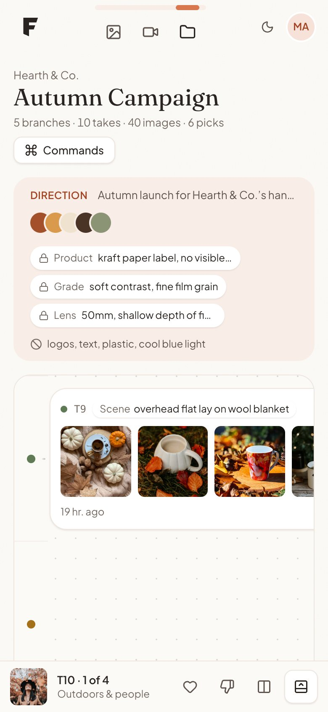

# FOMI — Frontend Assessment

Two parts of an AI creative platform, built with Next.js, JavaScript, Tailwind CSS and CSS Modules.

- **Part A — `/`**: the generation workspace from FOMI's mockup, implemented faithfully and then made production-grade: every state, every screen size, keyboard and screen-reader support.
- **Part B — `/studio`**: my own vision of the image-generation workspace — **Lineage**, a project canvas where every result keeps its ancestry and a new take is made by changing one ingredient of the recipe.

|                  | Link                                         |
| ---------------- | -------------------------------------------- |
| Live (Vercel)    | _added after deployment_                     |
| Repository       | _added after deployment_                     |
| Product thinking | [PRODUCT_THINKING.md](./PRODUCT_THINKING.md) |




| Branching in place                         | Compare with synced zoom                 | Part A on a phone                       | Studio on a phone                       |
| ------------------------------------------ | ---------------------------------------- | --------------------------------------- | --------------------------------------- |
|  |  |  |  |

---

## What to try

**Part A (`/`)**

- Write a prompt and press **Generate** (or **⌘/Ctrl + Enter**). Placeholders appear instantly in the exact aspect ratio, with staged progress; press **Esc** or the same button to cancel.
- Include the word **“fail”** in a prompt to see the error state (the prompt is kept, retry is one click).
- Hover a result for quick actions; click it for the full-size viewer (**← →**, **Esc**).
- Use the history strip or **History · View all** (paginated) to bring past runs back onto the canvas.
- Collapse the settings panel (button next to Image/Video, or **⌘/Ctrl + \\**) to give the results the full width.
- Prompts need at least 3 words; Generate tells you how many are missing. Styles can be combined.
- The page opens on an empty canvas with example prompts; past runs live in the history strip and open in the main area when you click them. Toggle the theme in the top bar.

**Part B (`/studio`)**

| Key            | Action                                                |
| -------------- | ----------------------------------------------------- |
| ← → ↑ ↓        | Move through a lane / jump between lanes              |
| **P** · **X**  | Pick · reject (picks collect in **Selects**)          |
| **B**          | Branch from the selected image: change one ingredient |
| **C** · **⇧C** | Add to compare · open compare (2–4, synced zoom/pan)  |
| **↵**          | Full-size viewer                                      |
| **⌘K** · **?** | Command bar · all shortcuts                           |

Branch with a value containing “fail” to see a failed take handled in place. **Export** downloads a hand-off of the selects with their recipes.

---

## Tech decisions

| Decision                                                        | Why                                                                                                                                                                                                                                                                                |
| --------------------------------------------------------------- | ---------------------------------------------------------------------------------------------------------------------------------------------------------------------------------------------------------------------------------------------------------------------------------- |
| **Next.js 16.4 (App Router), React 19.3, Node 24 LTS**          | Latest stable at build time; Node 24 is what Vercel runs. Pages are prerendered (`○ /`, `○ /studio`); the mock API is dynamic.                                                                                                                                                     |
| **JavaScript + JSDoc, checked by `tsc --checkJs`**              | JavaScript as required, but shared shapes (`Generation`, `Batch`, `Take`, `Recipe`…) are typed in JSDoc and verified in CI-style `yarn typecheck`, so the docs can't drift from the code. TypeScript 6 is used only as the checker (`typescript-eslint` doesn't support TS 7 yet). |
| **Tailwind v4 for layout, CSS Modules for the rest**            | Utilities for layout and states; CSS Modules where CSS is clearer: keyframes, the blur-up crossfade, the lineage dot grid and connector drawing.                                                                                                                                   |
| **One token file** (`src/styles/tokens.css`)                    | Colours, type scale, radii, shadows and motion live in a Tailwind `@theme static` block. Default palettes are cleared, so components can only use tokens; `static` emits every token because some are read from CSS Modules and inline styles.                                     |
| **Native `<dialog>` for every overlay**                         | Focus trapping, Escape and inertness from the platform. A small `useModalDialog` hook returns focus to the opener and survives React's StrictMode double-mount.                                                                                                                    |
| **Images from Unsplash's CDN via a custom `next/image` loader** | The CDN (imgix) crops and resizes at the edge, so we pass width/ratio instead of re-optimising. ~300-byte blur previews and dimensions are precomputed (`yarn media:build`) so tiles reserve space before the image arrives. Video posters are local WebP in two sizes.            |
| **No UI kit, minimal dependencies**                             | Next/React, `lucide-react` for icons and the tiny `server-only` guard — nothing else at runtime. All components (Select, Segmented, Tooltip, Accordion, Command palette…) are written for this project with ARIA patterns.                                                         |
| **State without libraries**                                     | Part A: a small reducer-based `useGenerate` (one request in flight, cancel, retry, stale-response guard). Part B: one `useStudio` reducer for the project tree, decisions, selection, compare set and in-flight branch.                                                            |

## Folder structure

```
src/
  app/
    (part-a)/page.js        Part A — "/"
    studio/page.js          Part B — "/studio"
    api/generate/route.js   POST: mocked generation
    api/history/route.js    GET: paginated history
    dev/                    design-system & API playground (404s in production)
    layout.js  globals.css  error.js  loading.js  not-found.js
  components/
    ui/        Button, IconButton, Select, Segmented, Accordion, Tooltip, Chip, Skeleton,
               Spinner, Kbd, Toaster, CommandPalette
    shared/    TopBar, PrimaryNav, ThemeToggle, MediaTile, MediaLightbox, …
    generate/  Part A feature components + useWorkspaceActions
    studio/    Part B feature components + useStudio, useBranching, useStudioCommands
    part-switcher/
  hooks/       useGenerate, useHistory, useComposerSettings, useHotkeys, useModalDialog, …
  lib/         api client, constants, types, format, image loader, theme
    mock/      server-only mock backend (validation, generation, history, studio project)
    studio/    recipe diffing & prompt compiling, lineage layout, navigation, export
  data/        curated media manifest, models, style presets, prompt sets, studio project
  styles/      design tokens
scripts/       media manifest builder, submission PDF builder
docs/          screenshots, submission template
```

## Getting started

```bash
nvm use            # Node 24 (see .nvmrc)
yarn install
yarn dev           # http://localhost:3000
```

| Script                         |                                                                                       |
| ------------------------------ | ------------------------------------------------------------------------------------- |
| `yarn lint`                    | ESLint (Next config), zero warnings allowed                                           |
| `yarn typecheck`               | Type-checks the JavaScript against its JSDoc                                          |
| `yarn format` / `format:check` | Prettier (+ Tailwind class order)                                                     |
| `yarn build` / `start`         | Production build                                                                      |
| `yarn media:build`             | Rebuilds `src/data/media-manifest.json` from the curated Unsplash ids (needs network) |
| `yarn docs:pdf`                | Builds the submission PDF from `PRODUCT_THINKING.md`                                  |

## Mock API

The goal is a realistic frontend architecture, not a backend. Both routes validate input and return consistent errors: `{ error: { code, message, field? } }`.

**`POST /api/generate`**

```json
{ "prompt": "…", "mode": "image" | "video", "count": 1 | 2 | 4 | 8, "aspectRatio": "1:1" | "4:5" | "2:3" | "3:4" | "16:9" | "9:16",
  "model": "fomi-portrait", "style": null, "advanced": { "seed": null, "guidance": 7, "negativePrompt": "", "quality": "standard" } }
```

- Waits a random **1.5–3 s**, stops early if the client aborts.
- Returns a `Batch` (`201`): `{ id, prompt, mode, model, style, aspectRatio, advanced, createdAt, items: Generation[] }`, where each item has `id, type, src, width, height, blurDataURL, alt, seed, …`.
- Results are chosen by matching the prompt to curated photo sets (portraits, neon streets, candles, knitwear…), so they look coherent. The **same seed reproduces** the same results.
- `400` for invalid input (e.g. `count: 3` → “Choose 1, 2, 4, or 8 results.”), `503` when the prompt contains “fail”.

**`GET /api/history?limit=12&cursor=…`** returns `{ items: Batch[], nextCursor }` with an opaque cursor; `400` for a bad cursor or limit.

The client wrapper (`src/lib/api.js`) checks `response.ok`, maps failures to a typed `ApiError` and passes `AbortSignal`s through.

## Accessibility

- Semantic landmarks, headings in order, labels on every control, prompts as alt text.
- Full keyboard use: skip link, visible focus rings everywhere, roving focus in grids, strips and radio groups, ARIA listbox/combobox patterns, Escape closes every overlay and focus returns to where it was.
- A polite live region announces “Generating 4 images…”, “4 images ready” and errors.
- Contrast checked numerically for both themes (WCAG AA). The mockup's Generate button (white on `#E59C87`) is 2.2:1, so the accent was deepened to `#B9502E` (4.9:1).
- Touch targets are 40 px; `prefers-reduced-motion` turns animation off.

## Performance

| Lighthouse (production build) | Performance | Accessibility | Best practices | SEO |
| ----------------------------- | ----------- | ------------- | -------------- | --- |
| `/` desktop                   | 100         | 100           | 100            | 100 |
| `/` mobile                    | 86–97       | 100           | 100            | 100 |
| `/studio` desktop             | 100         | 100           | 100            | 100 |
| `/studio` mobile              | 87–94       | 100           | 100            | 100 |

Desktop LCP ≈ 0.7 s, CLS ≈ 0. Mobile scores varied between runs because they were measured on a ~20–30 KB/s connection; they should be re-measured on the deployed site.

What moved the numbers: first-paint images are painted immediately (only new results fade in, since an image at opacity 0 doesn't count for LCP); `fetchpriority` favours result images over history thumbnails; square crops are requested for square thumbnails; video posters are sized WebP; dialogs, the viewer, advanced settings and compare are code-split, each with its own Suspense boundary; memoised tiles and stable callbacks keep typing in the prompt from re-rendering the grid.

## Known limitations

- **No real model.** Results are curated stock photos picked by keyword; Upscale is simulated.
- **No persistence.** Studio and Part A state live in memory — a reload resets them.
- Tested in Chrome (desktop and mobile emulation). Not yet verified on real iOS/Android devices or in Safari/Firefox.
- Studio lanes are not virtualised; that's fine for a project of this size, not for thousands of takes.
- Placeholders that point outside the scope: **Edit** (nav) is marked “coming soon”; **Support** is a mailto link.

## Credits

Photos from [Unsplash](https://unsplash.com) (Unsplash License), videos from [Mixkit](https://mixkit.co) (Mixkit License). Icons by [Lucide](https://lucide.dev).
